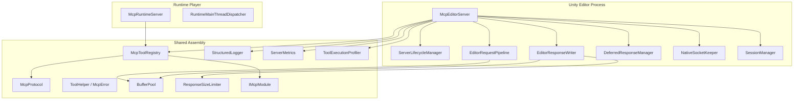
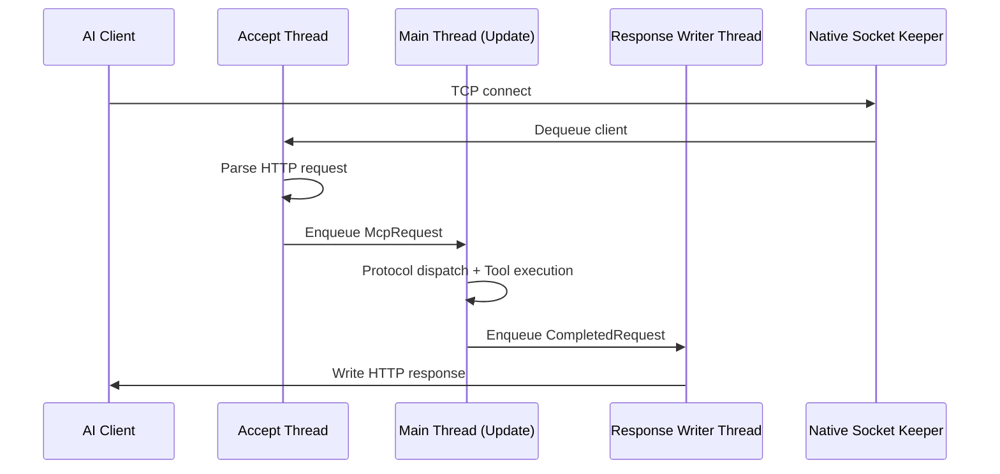
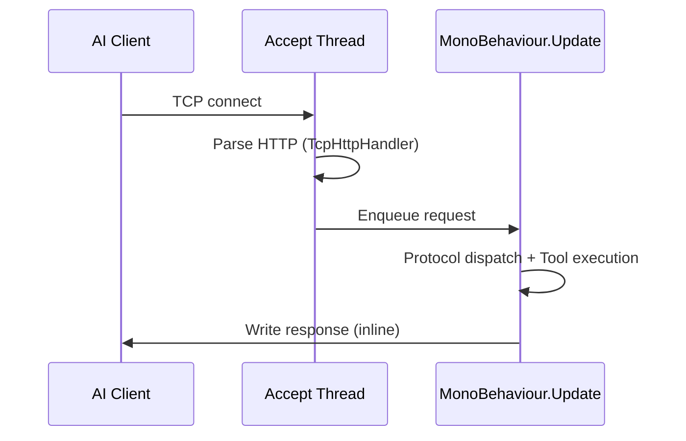
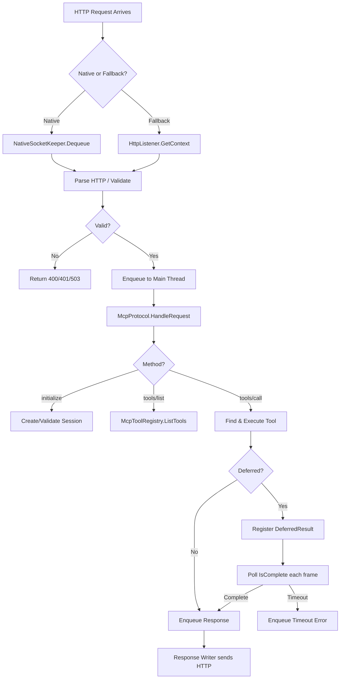
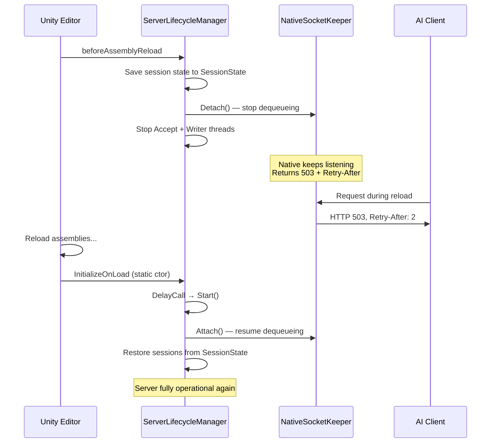
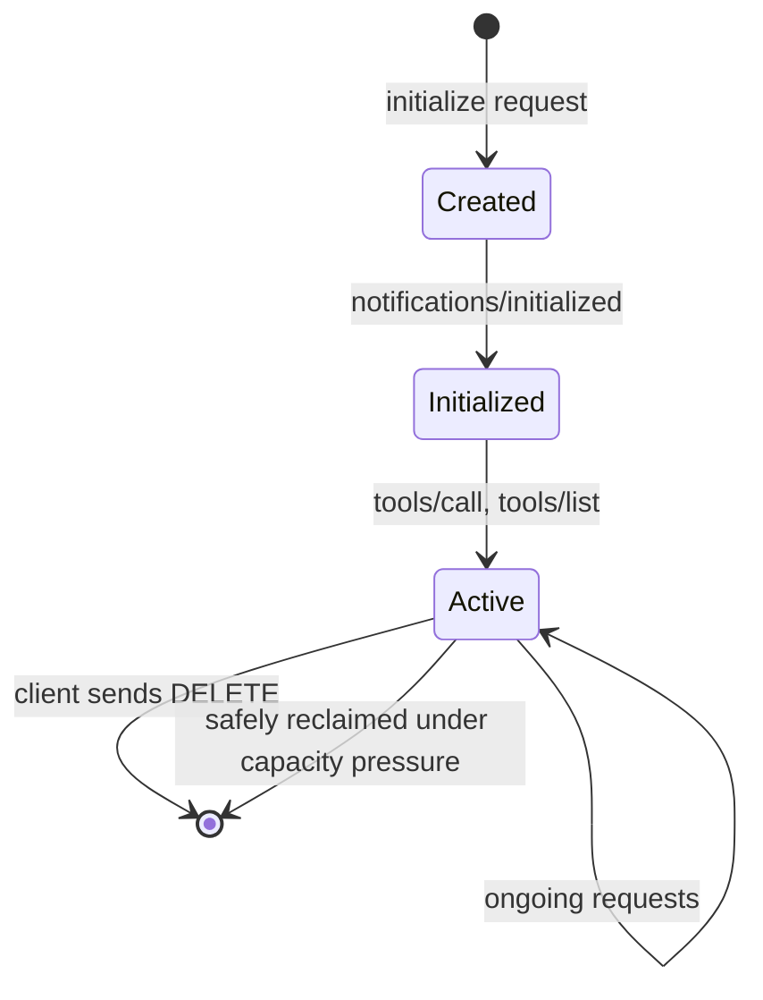
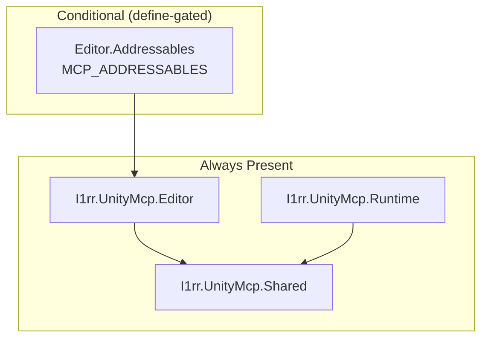

# Architecture

Internal architecture documentation for i1rr-unity-mcp contributors.

---

## High-Level Overview

i1rr-unity-mcp runs two server variants:

- **Editor Server** — HTTP-based, runs inside the Unity Editor process. Uses a 3-thread model with optional native socket keeper for domain reload resilience.
- **Runtime Server** — TCP-based, runs as a MonoBehaviour in development player builds. Uses a 2-thread model compatible with IL2CPP (no HttpListener).

Both share the `I1rr.UnityMcp.Shared` assembly for protocol handling, tool registry, security, utilities, and common infrastructure.



---

## Editor Server: Component Decomposition

The `McpEditorServer` class was decomposed into focused single-responsibility components:

| Component | File | Responsibility |
|-----------|------|---------------|
| `McpEditorServer` | `McpEditorServer.cs` | Orchestrator — wires components together, DrainInboundQueue |
| `ServerLifecycleManager` | `ServerLifecycleManager.cs` | Start/stop, domain reload handling, session persistence |
| `EditorRequestPipeline` | `EditorRequestPipeline.cs` | Accept thread, HTTP parsing, header validation, inbound queue |
| `EditorResponseWriter` | `EditorResponseWriter.cs` | Response serialization, outbound queue, HTTP writing |
| `DeferredResponseManager` | `DeferredResponseManager.cs` | Deferred result polling, timeout, cleanup |
| `SessionManager` | `Sessions/SessionManager.cs` | Multi-session lifecycle, stale reaping, concurrency limits |
| `NativeSocketKeeper` | `NativeSocketKeeper.cs` | P/Invoke wrapper for `mcpkeeper.dll` |

---

## Infrastructure Components

| Component | File | Purpose |
|-----------|------|---------|
| `BufferPool` | `Shared/Utilities/BufferPool.cs` | Pooled byte arrays for response serialization — reduces GC pressure |
| `StructuredLogger` | `Shared/Utilities/StructuredLogger.cs` | JSON-structured logging with severity levels and context fields |
| `ServerMetrics` | `Shared/Utilities/ServerMetrics.cs` | Request counters, error rates, connection tracking |
| `ToolExecutionProfiler` | `Shared/Utilities/ToolExecutionProfiler.cs` | Per-tool execution timing (avg/p95/max) |
| `ResponseSizeLimiter` | `Shared/Utilities/ResponseSizeLimiter.cs` | Automatic response truncation with pagination hints |
| `ToolHelper` | `Shared/Utilities/ToolHelper.cs` | Parameter extraction, pagination, common tool patterns |
| `McpError` / `McpErrorCodes` | `Shared/McpError.cs`, `Shared/McpErrorCodes.cs` | Structured error creation with standard error codes |
| `IMcpModule` | `Shared/IMcpModule.cs` | Interface for optional module registration and lifecycle |

---

## Editor Server: Thread Model

The Editor server uses three threads plus the Unity main thread:



### Thread Responsibilities

| Thread | Class | Role |
|--------|-------|------|
| **Accept Thread** | `EditorRequestPipeline` | Dequeues accepted connections from native keeper (or accepts from HttpListener), parses HTTP, validates headers, enqueues to inbound queue |
| **Main Thread** | `McpEditorServer.DrainInboundQueue` | Drains up to 20 requests/tick, runs protocol dispatch, executes tools, handles deferred results |
| **Response Writer** | `EditorResponseWriter` | Drains outbound queue, serializes HTTP responses, writes to native socket or HttpListener |

### Queue Architecture


- **Inbound Queue**: `ConcurrentQueue<McpRequest>`, capped at 200 entries. Overflow returns HTTP 503.
- **Outbound Queue**: `BlockingCollection<CompletedRequest>`, blocks the writer thread until work arrives.

---

## Runtime Server: Thread Model

The Runtime server uses two threads (compatible with IL2CPP stripping):



| Thread | Role |
|--------|------|
| **Accept Thread** | `TcpListener.AcceptTcpClient()`, parse HTTP, enqueue |
| **Main Thread (Update)** | Drain queue (max 3/frame), execute tools, write response directly on the client's `NetworkStream` |

The Runtime server writes responses synchronously on the main thread (no separate writer thread) because player builds cannot afford the overhead of a third thread and the response volume is lower.

---

## Request Lifecycle



### Authentication

1. Token is generated using `System.Security.Cryptography.RandomNumberGenerator` (256-bit, Base64url encoded) on first run. Stored at `Library/MCPServer.token` with filesystem permissions restricted to the current user.
2. Requests must include `Authorization: Bearer <token>` header.
3. Token comparison uses constant-time HMAC-based equality (prevents timing side-channel attacks).
4. Exception: `/health` endpoint returns `{"status":"ok"}` without auth (full details require auth).
5. Per-IP rate limiting (120 requests/minute) protects against brute-force attempts.

---

## Domain Reload Sequence

Unity reloads the C# domain on script changes, asset imports, and entering/exiting Play Mode. Without mitigation, this kills the HTTP server and drops all client connections.



### What Gets Preserved

| Data | Mechanism |
|------|-----------|
| TCP listening socket | Native DLL (`mcpkeeper.dll`) holds socket fd |
| Session IDs + state | `SessionState` (survives reload) |
| Protocol version per session | `SessionState` JSON array |
| Pending deferred results | **Lost** — clients get timeout errors |

### Fallback Mode (No Native DLL)

When `mcpkeeper.dll` is unavailable, the server uses `HttpListener`. During domain reload:
- The listener is disposed; clients get connection refused.
- Port file is preserved; clients can reconnect after reload.
- Sessions are still restored from `SessionState`.

---

## Native Socket Keeper

`mcpkeeper.dll` is a minimal native C library that:

1. **Owns the listening socket** — survives C# domain destruction.
2. **Accepts connections** — queues client fds for managed code.
3. **Returns 503 during reload** — when C# is detached, sends `HTTP/1.1 503 Service Unavailable` with `Retry-After: 2` to any connecting client.
4. **Provides raw I/O** — `mcpkeeper_recv`/`mcpkeeper_send` for direct socket read/write.

### API Surface

```
mcpkeeper_start(port)      → Start listening on port
mcpkeeper_attach()         → C# ready to handle requests
mcpkeeper_detach()         → C# going away (domain reload)
mcpkeeper_dequeue(ms)      → Get next accepted client fd (blocking with timeout)
mcpkeeper_recv/send(...)   → Raw socket I/O
mcpkeeper_close_client(id) → Close a client connection
mcpkeeper_stage_response() → Stage response bytes for flush
mcpkeeper_flush_staged()   → Flush all staged responses
mcpkeeper_stop()           → Stop and release the socket
```

The managed wrapper is `NativeSocketKeeper.cs` which checks DLL availability once and exposes a safe API.

---

## Session Management

### Multi-Session Support

The protocol layer retains up to 64 MCP client sessions by default in `McpProtocol`. These are
lightweight logical sessions, not open HTTP sockets. The separate Editor/Runtime `SessionManager`
types manage profiler recording sessions and are unrelated to MCP client identity.



### Session Lifecycle

1. **Creation**: Client sends `initialize` with `protocolVersion` and standard `clientInfo`. `McpProtocol` creates `McpSession`, captures client identity, and returns capabilities.
2. **Initialization**: Client sends `notifications/initialized`. Session marked ready.
3. **Active Use**: Client makes `tools/list` and `tools/call` requests. `LastActivityUtc` updated on each request.
4. **Termination**: Client sends HTTP `DELETE` to release its session cleanly. Sessions are never reaped below capacity.
5. **Capacity Pressure**: `MaxRetainedSessions` defaults to 64. At capacity, the server first looks for the oldest non-busy anonymous session from the same client fingerprint that has passed `AnonymousSessionReclaimGraceSeconds`. If none exists, it may reclaim any non-busy session past `SessionPruneIdleThresholdMinutes`. If every session is protected, initialization receives HTTP 503 with `Retry-After` and `session_capacity`.
6. **Stable Reconnect**: Clients that opt into i1rr-unity-mcp metadata with a stable `instanceId` replace only their own previous non-busy session while retaining their dashboard identity and counters.
7. **Domain Reload**: Protocol and client-observability state is serialized to `SessionState` via `ServerLifecycleManager` and restored after reload.

### Session ID Routing

Each request carries a session ID in the `Mcp-Session-Id` header. The protocol layer validates:
- Session exists
- Session is initialized (for non-`initialize` methods)
- Retained-session capacity can be satisfied by a same-client abandoned record or a generally stale non-busy record

### Client Identity and Observability

The server records standard `clientInfo` name, title, and version fields from `initialize`, plus
the HTTP `User-Agent` and remote address as diagnostic fallbacks. Dashboard identity is
self-reported and must not be treated as authentication.

Clients controlled by the team may add optional namespaced metadata:

```json
{
  "params": {
    "clientInfo": { "name": "test-runner", "title": "Test Runner", "version": "1.0" },
    "_meta": {
      "i1rr-unity-mcp/client": {
        "instanceId": "process-lifetime-uuid",
        "instanceName": "QA Worker",
        "kind": "automation",
        "runId": "playtest-42"
      }
    }
  }
}
```

Allowed `kind` values are `ai-agent`, `automation`, `ide`, and `test-runner`. Unknown values
are displayed as `unknown`. Multiple sessions from the same reported application receive
stable server-side ordinals such as `Codex #1` and `Codex #2`. In the example above, the
dashboard shows `Test Runner` as the MCP client and `QA Worker` as its host instance. A controlled
client can also provide `displayName` when its standard product title is not suitable for the UI.

Clients should keep one `Mcp-Session-Id` per logical server session and reuse it on every
subsequent request. Controlled clients should generate `instanceId` once per process lifetime,
not once per request. Same-client reclamation is only a defensive fallback for anonymous clients
that lose their session ID; it is not a substitute for client-side session ownership.

Below capacity, the server does not merge sessions by application name, User-Agent, or IP address:
multiple legitimate processes can share all three values. Same-family fingerprinting is used only
as a capacity-pressure fallback after the configured grace period. Standard clients should retain
and reuse `Mcp-Session-Id`; controlled clients should also provide a stable `instanceId`
so a reconnect can replace only its own previous, non-busy session.

---

## Optional Module System

Optional integrations are compiled only when their dependencies are present, using Unity's `versionDefines` in `package.json`:

```json
{
  "versionDefines": [
    {
      "name": "com.unity.addressables",
      "expression": "",
      "define": "MCP_ADDRESSABLES"
    }
  ]
}
```

### Module Architecture



### Adding a New Optional Module

1. Create a new folder: `Editor.MyModule/` or `Runtime.MyModule/`.
2. Create an asmdef referencing `I1rr.UnityMcp.Editor` (or Runtime) and your dependency.
3. Add `defineConstraints: ["MCP_MYMODULE"]` to the asmdef.
4. Add a `versionDefines` entry in `package.json` mapping the dependency package to `MCP_MYMODULE`.
5. Implement `IMcpModule` for lifecycle management:
   ```csharp
   public class MyModule : IMcpModule
   {
       public string Name => "MyModule";
       public void Initialize() { /* setup */ }
       public void Shutdown() { /* cleanup */ }
       public JObject GetHealthStatus() => new JObject { ["status"] = "ok" };
   }
   ```
6. Implement tools with `[McpTool]` — they are auto-discovered by the registry.

---

## Port Selection

The Editor server uses a deterministic port derived from the project path:

```
port = PortRangeStart + (FNV1a(projectPath) % PortRangeSize)
```

- Range: 8100–8999 (Editor), 9100–9999 (Runtime)
- If the computed port is in use, probes up to 10 adjacent ports.
- Port is written to `Library/MCPServer.port` for client discovery.
- Also written to `.vscode/mcp.json` for VS Code MCP client integration.

---

## Key Design Constraints

1. **Main thread execution**: All Unity API calls must happen on the main thread. Tools execute in `EditorApplication.update` (Editor) or `MonoBehaviour.Update` (Runtime).
2. **No async/await in tools**: Tool methods are synchronous. Use `DeferredResult` for waiting.
3. **IL2CPP compatibility**: Runtime server avoids `HttpListener` (stripped by IL2CPP). Uses raw `TcpListener` + manual HTTP parsing.
4. **Zero release footprint**: Runtime assembly uses `defineConstraints: ["DEVELOPMENT_BUILD"]` — excluded from shipping builds.
5. **Domain reload safety**: Static state is lost on reload. Use `SessionState` for persistence, native DLL for socket continuity.
6. **Security by default**: Localhost-only binding, CSPRNG tokens, constant-time comparison, restricted file permissions. LAN access is opt-in.

---

## Tool File Organization

Tools are organized into focused files by domain, following single-responsibility:

| Category | Files |
|----------|-------|
| Scene & Hierarchy | `SceneTools.cs` |
| Components | `ComponentReadTools.cs`, `ComponentWriteTools.cs` |
| Assets | `AssetSearchTools.cs`, `AssetInfoTools.cs`, `AssetOperationTools.cs` |
| Profiling | `FrameTimingTools.cs`, `MemoryProfilingTools.cs`, `ProfilerCounterTools.cs` |
| Perforce | `P4StatusTools.cs`, `P4EditTools.cs`, `P4DiffTools.cs` |
| Animation | `AnimationTools.cs` |
| Editor | `EditorControlTools.cs`, `CompilationTools.cs`, `ConsoleTools.cs` |
| Code & Types | `CodeSearchTools.cs`, `TypeReflectionTools.cs` |
| Utility | `UtilityTools.cs`, `ScreenshotTools.cs`, `CoroutineTools.cs`, `SessionTools.cs` |
| Files | `FileTools.cs` |
| Prefabs | `PrefabTools.cs` |
| Build | `BuildTools.cs` |

---

## Observability

### Structured Logging

`StructuredLogger` outputs JSON-formatted log entries with:
- Timestamp, severity level, message
- Context fields (session ID, tool name, request ID)
- Configurable minimum severity

### Metrics

`ServerMetrics` tracks:
- Total requests processed
- Error counts by error code
- Active connections
- Buffer pool usage (rented/returned)

### Tool Execution Profiling

`ToolExecutionProfiler` records per-tool:
- Invocation count
- Average execution time
- P95 and max execution time
- Exposed via the `/health` endpoint (authenticated) and `diagnostics` tool

---

## Testing

### Test Structure

- `Tests/Editor/` — Editor tool unit tests (NUnit, runs in Unity Test Runner)
- `Tests/Runtime/` — Runtime tool tests
- `Tests/run-tests.ps1` — CLI test execution script
- Repository maintainers pack the tested revision with `Tools~/pack_release.py`.

### Coverage Targets

- Infrastructure code (server, pipeline, sessions): 60%
- Tool implementations: 40%

### Static Analysis

Roslyn analyzers enforce:
- Nullable reference type annotations (`CS8600`–`CS8605` as errors)
- `IDisposable` pattern compliance (`CA2000`, `CA2213`)
- Consistent error handling patterns
