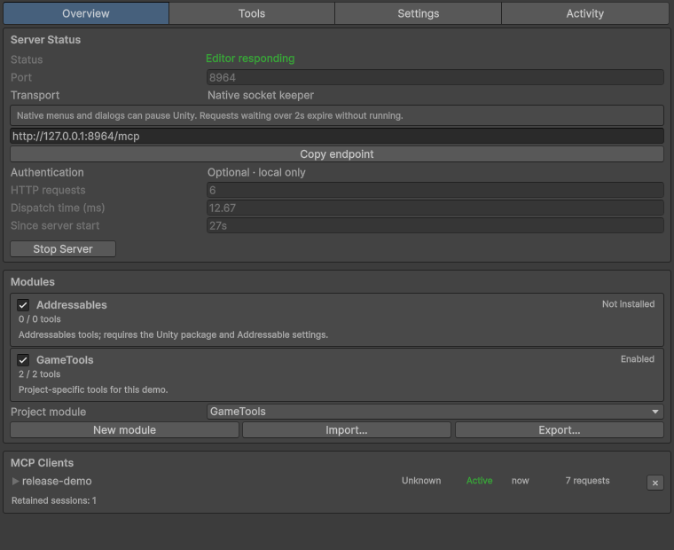
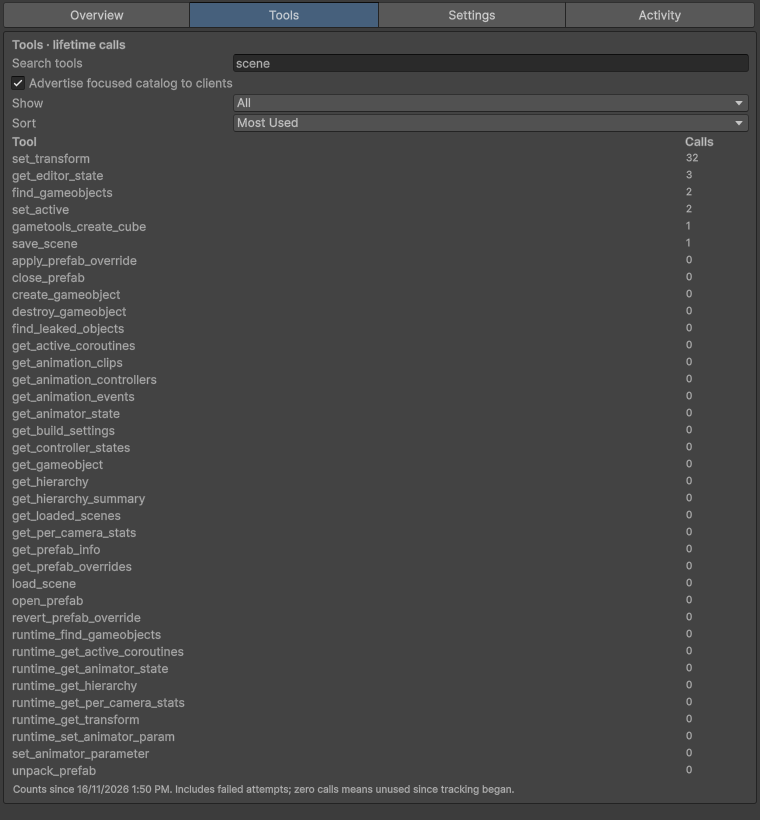
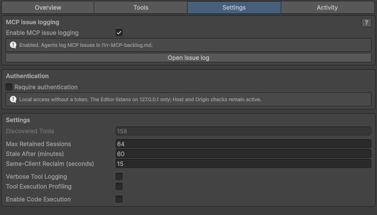
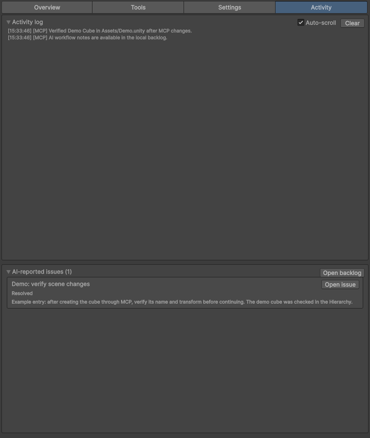

# Dashboard

Open **Tools > i1rr-unity-mcp Dashboard** in Unity. These screenshots use an empty
demo project with its own GameTools module.

## Overview

Copy the endpoint to connect a client. Check server status and connected clients.
Module checkboxes control their MCP tools; missing dependencies are shown too.
Use **New module**, **Import…** or **Export…** for project tools.

## Tools

Search by name, description or category. Filter and sort to find tools and see
their lifetime call counts. A focused catalog keeps the initial tool list small;
assistants can discover specialist tools when needed.

## Settings

Enable local issue logging or require a token for client connections. Other
controls manage sessions, logging and profiling. Code execution is optional and
disabled by default; ordinary tools and project modules work without it.

## Activity

Expand or collapse the activity log and AI issue panel independently. The log
shows MCP messages. AI issues are notes in your project's local backlog;
open an entry or its evidence from this panel. The screenshot contains a marked
example entry.

[Back to installation](../README.md)
