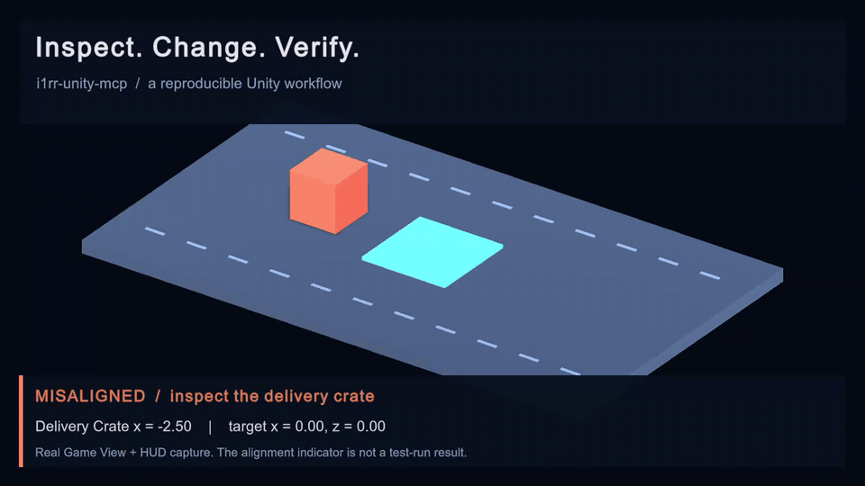
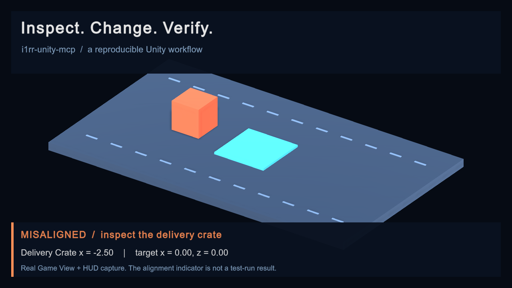
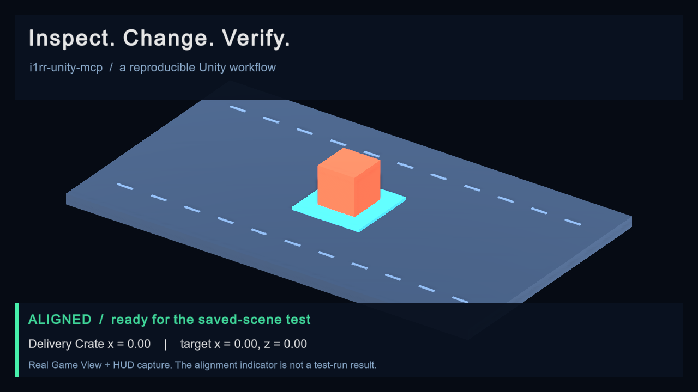

# Inspect, change, test and capture

This small scene gives a new user one reproducible task: center a delivery crate
on its landing pad. The initial saved scene deliberately fails one alignment
test. Use ordinary MCP scene tools to fix it, save the scene, and rerun the same
test. No arbitrary C# execution is needed.



The clip shows a live Play Mode preview through MCP, including the HUD. The
walkthrough below makes the persistent change in Edit Mode. The green HUD reports
current alignment; the separate Unity test verifies the saved scene.

## Create a disposable project

Use a new **3D Built-In Render Pipeline** project, rather than a game you are
working on. This example uses Unity's Standard shader. The walkthrough was
exercised on Windows with Unity **6000.6.9f1**, registry MCP **1.0.3** and Unity
Test Framework **1.8.0**. Other combinations need their own validation.

Clone or download the current repository. The example and helper are repository
files; they were added after the published 1.0.3 package.

If you have Python 3.9+, run this from the repository root, replacing the new
directory and exact installed Editor version:

```text
python Tools~/create_workflow_demo.py --project /path/to/new-demo --unity-version 6000.6.9f1
```

The helper refuses existing directories. It copies the example, writes a manifest
with the dedicated MCP scoped registry and test dependency, and creates the
version file. Open the new project in that Editor. Python is only an optional
project-creation helper; the MCP server itself runs inside Unity.

To set up without Python, create the empty project, follow the [package install](../README.md#install),
add Unity Test Framework 1.8.0 in Package Manager, and copy
[`Examples~/WorkflowDemo`](../Examples~/WorkflowDemo) to `Assets/McpWorkflowDemo`.

After compilation, choose **Tools > MCP Workflow Demo > Create scene**. It creates
`Assets/McpWorkflowDemo/WorkflowDemo.unity` and its materials. Running this menu
again resets the scene to the deliberately broken starting state, so use it only
in the disposable project. Close Unity's informational **Importing a scoped
registry** notice if shown, then [connect your local client](ConnectYourClient.md).

## Inspect and reproduce

1. Call `get_editor_state` and confirm this disposable project's identity and
   that compilation is settled. Load `Assets/McpWorkflowDemo/WorkflowDemo.unity`
   with `load_scene` if it is not already open.
2. Discover `get_gameobject` and inspect `{"path":"Delivery Crate"}`. The initial
   X position is **-2.5**. Inspect `Landing Pad`; its X and Z positions are **0**.
3. Call `list_tests` with `{"mode":"EditMode","query":"WorkflowDemo"}`. Select
   the exact case returned, then call `run_tests`:

```json
{
  "mode": "EditMode",
  "tests": ["WorkflowDemo.Tests.AlignmentTests.CrateIsCenteredOnLandingPad"]
}
```

Poll `get_test_run` with the returned `run_id` until completion. The initial result
should be **one failed case**, with the alignment assertion expecting zero and
observing -2.5. A compiler error, missing scene or cleanup exception is a setup
failure, not the intended demonstration. Read the failure message before fixing
anything. Retain the run ID or NUnit XML for comparison.

## Change the saved scene and verify recovery

Stay in **Edit Mode**. Reinspect the crate after a test run or reload; do not reuse
an old object ID. Call `set_transform` with the current numeric `instanceId`,
`position` set to `{"x":0,"y":0.63,"z":0}` and `space` set to `World`. Keep its
scale and rotation. Call `save_scene`, then inspect the transform again.

Rerun the exact same case using a new run ID, or omit `run_id` for a new run.
Do not reuse the failed run's ID: IDs identify one request and its recorded
result. The result should now be **one passed case, zero failed**. The assertion
loads a temporary preview of the saved scene, so an unsaved transform or Play
Mode-only edit cannot satisfy it. It closes that preview without replacing the
user's open scenes.

## Check what actually renders

Call `configure_game_view` with `{"width":1280,"height":720}`, then
`enter_play_mode`. Wait until `get_editor_state` reports normal, unpaused Play
Mode. Call `take_screenshot` with `{"capture_source":"game_view","format":"png"}`.
Inspect the saved image: the crate should sit on the cyan pad, and the composited
HUD should show X = 0.00 and ALIGNED. This checks the framebuffer and overlays,
rather than only the transform value. Copy a capture you want to keep before its
temporary-cache expiry.

| Initial scene | Saved correction |
| --- | --- |
|  |  |

For a short live preview, `capture_game_view_sequence` can record bounded Game
View video while Play Mode is running. Poll `get_game_view_sequence` for its
completion and paths. The clip above captures the actual transform change through
MCP; it is not a rendered mockup. Play Mode changes are temporary: exit and make
the saved Edit Mode correction before judging the persistent test.

Finish with `exit_play_mode` and `configure_game_view {"restore":true}` to restore
the previous Game View selection.

## Evidence and ways to help

The checked workflow produced the expected initial alignment failure and the
same case passed after the saved correction. Both 1280 × 720 composited captures
were inspected. This is one small Editor workflow, not proof of a native player,
other Unity versions, physical input or all AI clients. The release's broader
test evidence is separate in [v1.0.3](https://github.com/i1rr/unity-MCP/releases/tag/v1.0.3).

Try it with your client and report the exact package, Unity, OS and client versions
plus the first step that failed—or confirm the complete path worked. See
[client validation](https://github.com/i1rr/unity-MCP/issues/5),
[macOS/Linux validation](https://github.com/i1rr/unity-MCP/issues/6), and the
[contributor guide](../CONTRIBUTING.md). Exclude credentials and private project
files from shared evidence.
