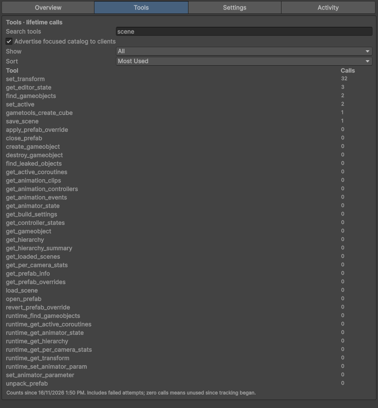
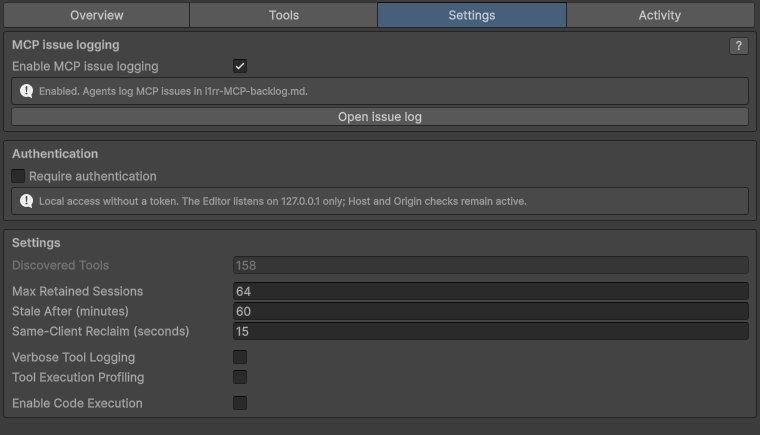

# i1rr-unity-mcp

## Install

Requires Unity 2022.3+ and Git.

1. In Unity Package Manager, choose **Install package from Git URL** and paste:

   ```text
   https://github.com/i1rr/unity-MCP.git#v1.0.0
   ```

2. Open **Tools > i1rr-unity-mcp Dashboard**.
3. Connect your AI assistant's HTTP MCP client to the endpoint in **Overview**.
   A VS Code MCP configuration is also created in your project.

## Capabilities

- Inspect and edit scenes, GameObjects, components and assets.
- Run Unity tests and inspect Play Mode and development players.
- Capture Game View screenshots and video.
- Use optional Addressables tools when that integration is installed.
- Create project tools and import or export modules for other projects.
- Let AI assistants record MCP issues locally and read them from the Dashboard.

## Dashboard

### Overview

Check the server, copy the connection endpoint and manage clients and modules.
Use **New module**, **Import…** and **Export…** for your project tools.


### Tools

Search the tool catalog, filter results and see which tools are being used.



### Settings

Configure authentication, local MCP issue logging and tool settings.



### Activity

Read MCP logs and AI-reported issues. Expand either panel or open a backlog entry.
The screenshot shows an example issue from an empty demo project.


## License

[The i1rr Community License](LICENSE.md) allows personal and commercial development,
free forks and modifications, and selling what you build with the MCP.

Selling, hosting or bundling the MCP as a paid offering requires written
permission: [i1rr.dev@gmail.com](mailto:i1rr.dev@gmail.com).
