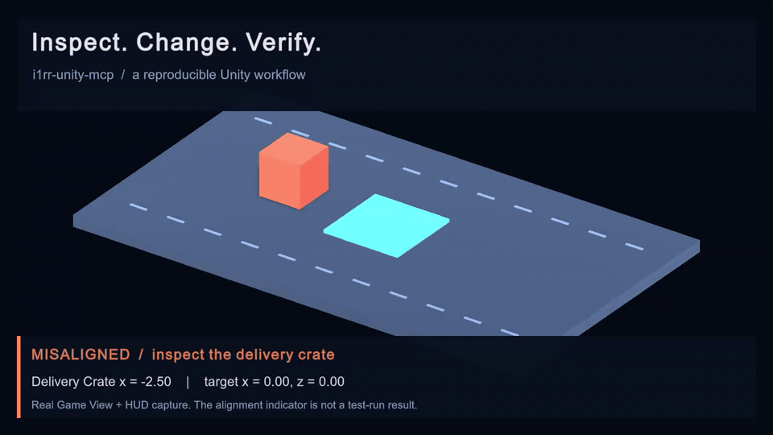
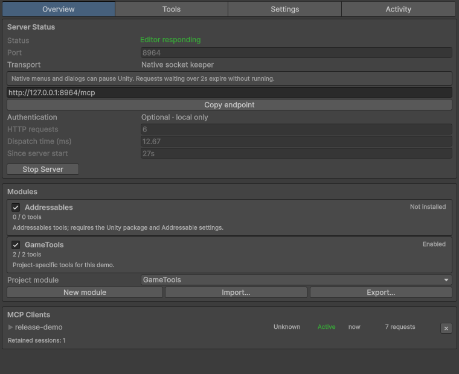
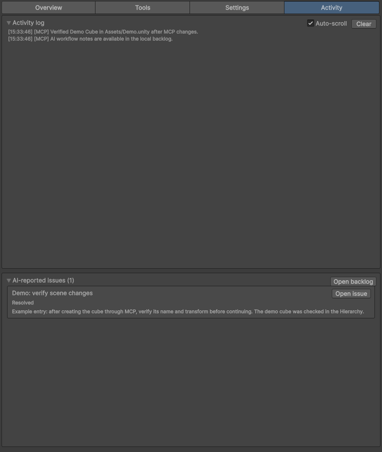

# i1rr-unity-mcp

Connect your AI assistant to a running Unity Editor: inspect a problem, change
the project, run a test and capture what the game actually renders.

The server runs inside Unity and accepts local HTTP MCP connections. The Editor
workflow needs no separate Node.js or Python bridge. Use your existing AI client;
its subscription or API costs are separate.

- **Inspect and edit:** scenes, GameObjects, components and assets.
- **Verify:** Unity tests, Play Mode, composited Game View screenshots and video.
- **Extend:** project-owned C# tools and reusable source modules.

[Connect your client](Documentation~/ConnectYourClient.md) ·
[Try the workflow demo](Documentation~/WorkflowDemo.md) ·
[Contribute](CONTRIBUTING.md) ·
[Report a bug](https://github.com/i1rr/unity-MCP/issues/new?template=bug_report.yml)



The [reproducible demo](Documentation~/WorkflowDemo.md) starts with a failing
saved-scene test, fixes the crate's transform and reruns the same test. The clip
previews the visible edit in Play Mode; the tutorial saves it in Edit Mode.

## Install

Requires Unity 2022.3+. The latest release was exercised on **Windows with Unity
6000.6.9f1**; the declared minimum and other operating systems are not a claim of
fresh validation. See the [release evidence](https://github.com/i1rr/unity-MCP/releases/tag/v1.0.3).

1. Open **Edit > Project Settings > Package Manager** and add a scoped registry:

   | Field | Value |
   | --- | --- |
   | Name | i1rr |
   | URL | `https://i1rr.github.io/unity-MCP` |
   | Scope | `i1rr-unity-mcp` |

2. Open **Window > Package Management > Package Manager**, choose **Install package
   by name** from the **+** menu, and enter `i1rr-unity-mcp`.
3. Open **Tools > i1rr-unity-mcp Dashboard** and connect your AI assistant's HTTP
   MCP client to the endpoint in **Overview**. A VS Code MCP configuration is also
   created in your project.

Refresh Package Manager to check for new releases, then select the MCP to update.

Already using the npm registry? Change its URL to the one above, keeping the
exact scope `i1rr-unity-mcp`, then refresh Package Manager. No npm account is needed.

### Install from Git

With Git installed, choose **Install package from Git URL** in Package Manager:

   ```text
   https://github.com/i1rr/unity-MCP.git#v1.0.3
   ```

Git installs stay on their selected release. To use registry updates, remove the
Git-installed package and follow the registry installation steps above.

## Capabilities

- Inspect and edit scenes, GameObjects, components and assets.
- Run Unity tests and inspect Play Mode and development players.
- Capture Game View screenshots and video.
- Use optional Addressables tools when that integration is installed.
- Create project tools and import or export modules for other projects.
- Let AI assistants record MCP issues locally and read them from the Dashboard.

## Try your first workflow

Start in an empty or disposable project with the Editor open. After connecting
your client, ask:

> Call get_editor_state and confirm the project and Unity version. Inspect the
> active scene. Create a cube named MCP First Cube at (0, 1, 0), tell me which
> tool changed it, and read its transform back to verify the result.

Specialist tools are discovered on demand. If your client cannot expose newly
discovered tools, select the full catalog in the Dashboard and reconnect.
For test runs, first use `list_tests` to find actual cases in your project; an
empty project does not contain a gameplay test suite.

For a visual check, enter Play Mode and capture the composited Game View with
`take_screenshot`. The camera must frame your subject; creating an object alone
does not prove it is visible. [Client setup and troubleshooting](Documentation~/ConnectYourClient.md)
explain connection checks and common failures.

## Help shape the project

We welcome bug reports, documentation fixes, small PRs and compatibility reports.
Pick a [good first issue](https://github.com/i1rr/unity-MCP/labels/good%20first%20issue)
or read the [contributor guide](CONTRIBUTING.md) for the local test workflow.
Please include your Unity version, operating system and AI client when reporting
an installation or connection result. Successful installs are useful evidence too.

## Dashboard

### Overview

Check the server, copy the connection endpoint and manage clients and modules.
Use **New module**, **Import…** and **Export…** for your project tools.



### Tools

Search the tool catalog, filter results and see which tools are being used.


### Settings

Configure authentication, local MCP issue logging and tool settings.


### Activity

Read MCP logs and AI-reported issues. Expand either panel or open a backlog entry.
The screenshot shows an example issue from an empty demo project.



## Security

Use Unity Package Manager, not `npm install`. Connect trusted AI clients;
arbitrary C# execution is off by default. See [security and scanner reports](SECURITY.md).

## License

Source is available under [the i1rr Community License](LICENSE.md). It allows personal and commercial development,
free forks and modifications, and selling what you build with the MCP.

Selling, hosting or bundling the MCP as a paid offering requires written
permission: [i1rr.dev@gmail.com](mailto:i1rr.dev@gmail.com).
